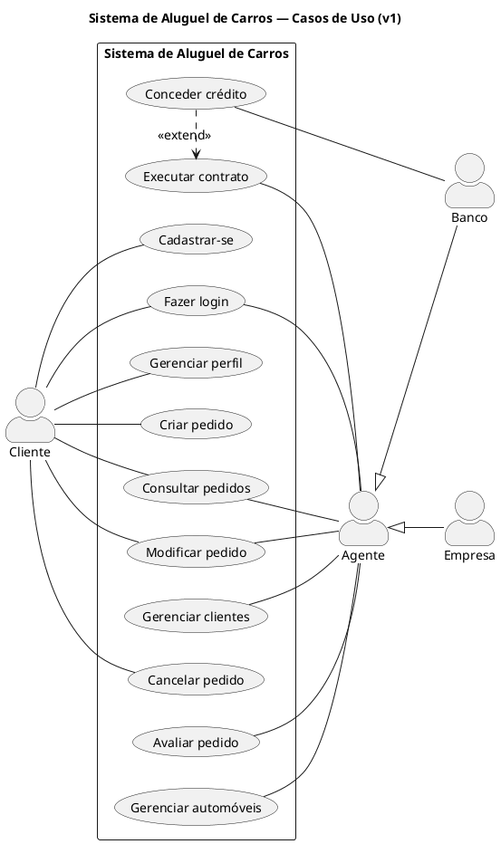
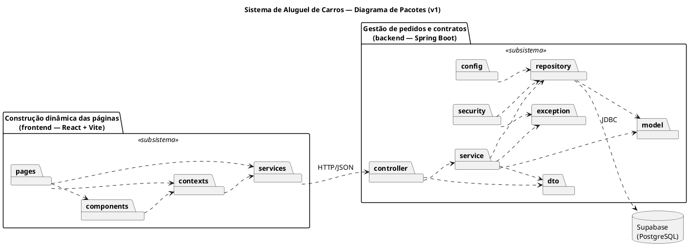
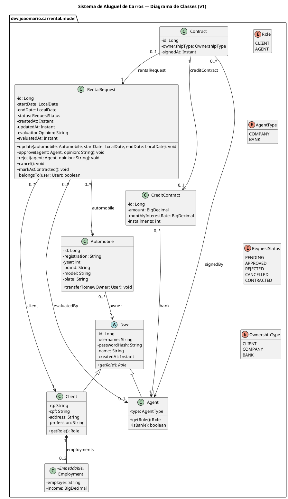

# 🚗 Sistema de Aluguel de Carros

<table>
  <tr>
    <td width="800px">
      <div align="justify">
        Sistema web para <b>aluguel de automóveis</b>. Clientes se cadastram e fazem <i>pedidos de aluguel</i>; agentes (uma locadora e um banco) <i>avaliam os pedidos</i> do ponto de vista financeiro e, com parecer positivo, <b>executam o contrato</b>, que pode vir com um <b>contrato de crédito</b> concedido pelo banco. Back-end em <b>Spring Boot</b>, front-end em <b>React + Vite</b> e banco no <b>Supabase</b>, seguindo a arquitetura <b>MVC</b>.
      </div>
    </td>
  </tr>
</table>

---

## 🚧 Status do Projeto

[](#-licença)

     

> [!NOTE]
> Projeto em construção. A modelagem (histórias de usuário e diagramas UML) está pronta; o código vem nas próximas etapas.

---

## 🔗 Links Úteis

- 🌐 **Aplicação:** [aluguel-carros.vercel.app](https://aluguel-carros.vercel.app/)
- 📖 **Documentação da API (Swagger):** [car-rental-system-h9qt.onrender.com/swagger-ui.html](https://car-rental-system-h9qt.onrender.com/swagger-ui.html)

> [!TIP]
> A API usa o plano gratuito do Render, que desliga depois de alguns minutos sem uso. O primeiro acesso depois disso pode levar cerca de 1 minuto.

---

## 📚 Índice

- [Links Úteis](#-links-úteis)
- [Sobre o Projeto](#-sobre-o-projeto)
- [Funcionalidades Previstas](#-funcionalidades-previstas)
- [Tecnologias Utilizadas](#-tecnologias-utilizadas)
- [Arquitetura](#-arquitetura)
- [Instalação e Execução](#-instalação-e-execução)
- [Deploy](#-deploy)
- [Estrutura de Pastas](#-estrutura-de-pastas)
- [Demonstração](#-demonstração)
- [Testes](#-testes)
- [Autor](#-autor)
- [Licença](#-licença)

---

## 📝 Sobre o Projeto

Este é o LAB02 de Desenvolvimento e Integração de Aplicações Web (DIAW), na PUC Minas. O objetivo é **modelar e construir** um sistema de aluguel de carros, mantendo o modelo UML e o código alinhados do começo ao fim.

O sistema só pode ser usado após cadastro e login. **Clientes** pedem o aluguel de um automóvel e acompanham o status do pedido. **Agentes** (empresas e bancos já cadastrados) avaliam os pedidos e executam os contratos. Ao fim do contrato, o automóvel fica registrado como propriedade do cliente, da empresa ou do banco.

As regras do sistema estão nas [histórias de usuário](./docs/historias-de-usuario.md).

---

## ✨ Funcionalidades Previstas

- 🔐 **Cadastro e login** de clientes, e login de agentes, com usuário e senha.
- 👤 **Perfil do cliente** com RG, CPF, endereço, profissão e até 3 empregadores com rendimentos.
- 📝 **Pedidos de aluguel:** o cliente cria, consulta, modifica e cancela os seus pedidos.
- ✅ **Avaliação financeira:** o agente aprova ou reprova o pedido com um parecer.
- 📄 **Contrato:** com parecer positivo, o agente executa o contrato e define o proprietário do automóvel.
- 🏦 **Contrato de crédito** concedido por um banco agente.
- 🚘 **Gestão de automóveis e clientes** pelos agentes.

---

## 🛠 Tecnologias Utilizadas

### 💻 Front-end

- **React 19** com **Vite 8** e **React Router 7**
- **JavaScript** e **CSS Modules**

### 🖥️ Back-end

- **Java 25** com **Spring Boot 4** e **Maven**
- **Spring Web MVC**, **Spring Data JPA** e **Bean Validation**
- **Spring Security** com **JWT** (JJWT)
- **Supabase (PostgreSQL)** como banco de dados
- **JUnit 5** e **Mockito** nos testes

### 📐 Modelagem

- **PlantUML** para os diagramas

---

## 🏗 Arquitetura

O sistema segue o padrão **MVC** e é dividido em dois subsistemas, que só conversam por HTTP/JSON:

- **Construção dinâmica das páginas** (`frontend/`): é a **View**. As páginas em React chamam a API por uma camada de `services`.
- **Gestão de pedidos e contratos** (`backend/`): os **Controllers** recebem as requisições, os **Services** aplicam as regras de negócio e o **Model** (entidades e repositórios) guarda os dados no Supabase.

O navegador nunca acessa o banco: só o back-end fala com o Supabase.

### Diagramas (v1)

| Casos de Uso | Pacotes |
| :---: | :---: |
|  |  |

| Classes |
| :---: |
|  |

As versões dos modelos e o que mudou entre elas estão em [`docs/uml/README.md`](./docs/uml/README.md).

---

## 🔧 Instalação e Execução

🚧 Em construção.

---

## 🚀 Deploy

O back-end roda no **Render** a partir do `backend/Dockerfile`, e o front-end na **Vercel**. Os dois usam o mesmo banco do Supabase.

### 🖥️ Back-end no Render

1. Crie um **Web Service** ligado a este repositório, com linguagem **Docker** e **Root Directory** `backend`.
2. Cadastre as variáveis de ambiente (os valores ficam só no Render, nunca no código):

   | Variável | Uso |
   | --- | --- |
   | `DB_URL`, `DB_USERNAME`, `DB_PASSWORD` | Conexão com o Supabase (session pooler) |
   | `JWT_SECRET` | Assinatura dos tokens (gere com `openssl rand -base64 32`) |
   | `SEED_AGENT_PASSWORD` | Senha da locadora e do banco criados na primeira execução |
   | `CORS_ALLOWED_ORIGINS` | URL do front-end na Vercel |

   O Render define a variável `PORT` sozinho, e o Spring usa essa porta.

3. A cada push na `main`, o Render gera a imagem Docker e publica a nova versão.

### 💻 Front-end na Vercel

1. Importe este repositório na Vercel com **Root Directory** `frontend` (o preset Vite é detectado sozinho).
2. Cadastre a variável `VITE_API_URL` com a URL do back-end no Render, sem barra no final. Ela é lida no build: se mudar, faça um novo deploy.
3. O `frontend/vercel.json` manda todas as rotas para o `index.html`, para que recarregar uma página como `/pedidos/12` não dê erro 404.

Depois do primeiro deploy na Vercel, coloque a URL dela em `CORS_ALLOWED_ORIGINS` no Render.

---

## 📂 Estrutura de Pastas

Estrutura planejada:

```
.
├── docs/
│   ├── historias-de-usuario.md  # 📝 Histórias de usuário e regras de negócio.
│   ├── assets/                  # 🖼️ Imagens do README.
│   └── uml/                     # 📐 Diagramas UML, uma pasta por versão.
├── backend/                     # 🖥️ API em Spring Boot.
│   └── src/main/java/dev/joaomario/carrental/
│       ├── controller/          # 🚪 Endpoints REST.
│       ├── service/             # ⚙️ Regras de negócio.
│       ├── repository/          # 🗃️ Acesso ao banco.
│       ├── model/               # 🧱 Entidades e enums.
│       ├── dto/                 # 📦 Dados de entrada e saída da API.
│       ├── security/            # 🔐 Login e JWT.
│       ├── config/              # 🔧 Configurações e carga inicial.
│       └── exception/           # ⚠️ Tratamento de erros.
└── frontend/                    # 💻 Interface em React + Vite.
    └── src/
        ├── pages/               # 📄 Telas.
        ├── components/          # 🧩 Peças reutilizáveis.
        ├── services/            # 🔌 Chamadas à API.
        ├── contexts/            # 👤 Sessão do usuário.
        └── styles/              # 🎨 Tokens e estilos globais.
```

---

## 🎥 Demonstração

🚧 Em construção.

---

## 🧪 Testes

🚧 Em construção.

---

## 👤 Autor

| 👤 Nome | 🖼️ Foto | :octocat: GitHub | 💼 LinkedIn | 📤 Gmail |
| --- | :---: | :---: | :---: | :---: |
| João Mário Abreu |  | <a href="https://github.com/joaom-abreu"></a> | <a href="https://www.linkedin.com/in/joao-mario-abreu"></a> | <a href="mailto:abreujoaomr@gmail.com"></a> |

---

## 📄 Licença

Este projeto é distribuído sob a **[Licença MIT](./LICENSE)**.
