# 🚗 Sistema de Aluguel de Carros

<table>
  <tr>
    <td width="800px">
      <div align="justify">
        Sistema web para <b>aluguel de automóveis</b>. Clientes se cadastram e fazem <i>pedidos de aluguel</i>; agentes (uma locadora e um banco) <i>avaliam os pedidos</i> do ponto de vista financeiro e, com parecer positivo, <b>executam o contrato</b>, que pode vir com um <b>contrato de crédito</b> concedido pelo banco. Back-end em <b>Spring Boot</b>, front-end em <b>React + Vite</b> e banco no <b>Supabase</b>, seguindo a arquitetura <b>MVC</b>.
      </div>
    </td>
  </tr>
</table>

---

## 🚧 Status do Projeto

[](https://github.com/joaom-abreu/car-rental-system/actions/workflows/ci.yml) [](https://github.com/joaom-abreu/car-rental-system/releases) [](#-licença)

      

---

## 📚 Índice

- [Links Úteis](#-links-úteis)
- [Sobre o Projeto](#-sobre-o-projeto)
- [Funcionalidades](#-funcionalidades)
- [Tecnologias Utilizadas](#-tecnologias-utilizadas)
- [Arquitetura](#-arquitetura)
- [Instalação e Execução](#-instalação-e-execução)
- [Deploy](#-deploy)
- [Estrutura de Pastas](#-estrutura-de-pastas)
- [Demonstração](#-demonstração)
- [Endpoints da API](#-endpoints-da-api)
- [Testes](#-testes)
- [Documentações Utilizadas](#-documentações-utilizadas)
- [Autor](#-autor)
- [Licença](#-licença)

---

## 🔗 Links Úteis

- 🌐 **Aplicação:** [aluguel-carros.vercel.app](https://aluguel-carros.vercel.app/)
- 🎨 **Design system:** [aluguel-carros.vercel.app/design](https://aluguel-carros.vercel.app/design)
- 📖 **Documentação da API (Swagger):** [car-rental-system-h9qt.onrender.com/swagger-ui.html](https://car-rental-system-h9qt.onrender.com/swagger-ui.html)
- 📐 **Modelos UML e histórico de versões (v1, v2 e v3):** [`docs/uml`](./docs/uml/README.md)
- 📝 **Histórias de usuário:** [`docs/historias-de-usuario.md`](./docs/historias-de-usuario.md)

### 🔑 Contas de demonstração

Use estas contas para testar a aplicação online. Os dados são fictícios.

| Perfil | Usuário | Senha | O que dá para testar |
| --- | --- | --- | --- |
| Locadora (agente) | `locadora` | `aluguel2026` | Avaliar pedidos, executar contratos, gerenciar clientes e automóveis |
| Banco (agente) | `banco` | `aluguel2026` | O mesmo da locadora, mais a concessão de contrato de crédito |
| Cliente | `cliente.demo` | `aluguel2026` | Criar, modificar, consultar e cancelar pedidos e editar o perfil |

O `cliente.demo` já tem um pedido em cada status, e o contratado tem crédito do banco. Também dá para criar um cliente novo na tela **Cadastre-se**.

> [!WARNING]
> Estas contas são públicas. Se for se cadastrar, use dados fictícios: os agentes veem os dados de todos os clientes.

> [!TIP]
> A API usa o plano gratuito do Render, que desliga depois de alguns minutos sem uso. O primeiro acesso depois disso pode levar cerca de 1 minuto.

---

## 📝 Sobre o Projeto

Este é o LAB02 de Desenvolvimento e Integração de Aplicações Web (DIAW), na PUC Minas. O objetivo é **modelar e construir** um sistema de aluguel de carros, mantendo o modelo UML e o código alinhados do começo ao fim.

O sistema só pode ser usado após cadastro e login. **Clientes** pedem o aluguel de um automóvel e acompanham o status do pedido. **Agentes** (uma locadora e um banco, já cadastrados) avaliam os pedidos e executam os contratos. Ao executar o contrato, o automóvel fica registrado como propriedade do cliente, da empresa ou do banco.

A modelagem veio antes do código: histórias de usuário e diagramas de casos de uso, classes e pacotes (v1). No fim, os diagramas foram refeitos a partir do código (v2) e, depois do tema claro e escuro, o de pacotes ganhou uma v3. As diferenças entre as versões estão explicadas em [`docs/uml/README.md`](./docs/uml/README.md). As classes, os atributos, os enums e os pacotes dos diagramas têm os mesmos nomes do código.

Na segunda etapa, o front-end ganhou um **design system**: paleta montada a partir do círculo cromático, tema claro e escuro, tipografia, componentes reutilizáveis e regras de acessibilidade, tudo documentado na página [`/design`](https://aluguel-carros.vercel.app/design).

---

## ✨ Funcionalidades

- 🔐 **Cadastro e login** com usuário e senha (JWT). O cliente se cadastra; os agentes já vêm criados.
- 👤 **Perfil do cliente** com RG, CPF, endereço, profissão e até 3 empregos com rendimento. O cliente edita os dados e pode excluir a conta.
- 📝 **Pedidos de aluguel:** o cliente escolhe o automóvel e o período, acompanha o status e pode modificar (em análise) ou cancelar (em análise ou aprovado).
- ✅ **Avaliação financeira:** o agente aprova ou reprova o pedido com um parecer. Um automóvel não pode ter dois pedidos aprovados no mesmo período.
- 📄 **Contrato:** com o pedido aprovado, o agente executa o contrato e define o proprietário do automóvel (cliente, empresa ou banco).
- 🏦 **Contrato de crédito:** só o banco pode conceder, com valor, juros ao mês e parcelas. Propriedade do banco exige crédito.
- 🚘 **Gestão de automóveis:** os agentes cadastram, editam e excluem automóveis; todos veem a lista com o proprietário.
- 👥 **Gestão de clientes:** os agentes listam, buscam por nome ou CPF, editam e excluem clientes.
- 🌗 **Tema claro e escuro:** um botão no topo troca o tema, e a escolha fica salva no navegador.
- 🎨 **Design system:** a página `/design` documenta a marca, os dois temas, a paleta (círculo cromático, escalas e tokens), a tipografia, os espaçamentos, os ícones, os botões, os componentes e as regras de acessibilidade com o contraste medido. Não precisa de login e pode ser exportada em PDF.

Os status do pedido são: **Em análise**, **Aprovado**, **Reprovado**, **Cancelado** e **Contratado**.

---

## 🛠 Tecnologias Utilizadas

### 💻 Front-end

- **React 19** com **Vite 8** e **React Router 7**
- **JavaScript** e **CSS Modules**, com tokens de cor e espaçamento em `styles/tokens.css` (tema claro e escuro)
- **lucide-react** para os ícones
- Fontes **Chakra Petch** (logo e títulos) e **Inter** (texto), do Google Fonts
- **oxlint** para o lint

### 🖥️ Back-end

- **Java 25** com **Spring Boot 4** e **Maven**
- **Spring Web MVC**, **Spring Data JPA** e **Bean Validation**
- **Spring Security** com **JWT** (JJWT) e senhas com **BCrypt**
- **springdoc-openapi** para a documentação **Swagger**
- **Supabase (PostgreSQL)** como banco de dados
- **JUnit 5**, **Mockito** e **MockMvc** nos testes

### ☁️ Infraestrutura

- **GitHub Actions** para o CI
- **Docker** para a imagem do back-end
- **Render** (back-end) e **Vercel** (front-end) para o deploy

### 📐 Modelagem

- **PlantUML** para os diagramas

---

## 🏗 Arquitetura

O sistema segue o padrão **MVC** e é dividido em dois subsistemas, que só conversam por HTTP/JSON:

- **Construção dinâmica das páginas** (`frontend/`): é a **View**. As páginas em React chamam a API só pela camada de `services`. O visual sai de componentes reutilizáveis (`Button`, `Field`, `Card`, `Alert`, `StatusBadge`, `Logo`), que usam só os tokens de `styles/tokens.css`.
- **Gestão de pedidos e contratos** (`backend/`): os **Controllers** recebem as requisições e devolvem DTOs, os **Services** aplicam as regras de negócio e a checagem de dono e de perfil, e o **Model** (entidades e repositórios) guarda os dados no Supabase. As regras de mudança de status ficam nos métodos da própria entidade `RentalRequest` (`approve`, `reject`, `cancel`, `markAsContracted`).

O navegador nunca acessa o banco: só o back-end fala com o Supabase.

### Diagramas atuais

Casos de uso e classes na v2; pacotes na v3.

| Casos de Uso (v2) | Pacotes (v3) |
| :---: | :---: |
| 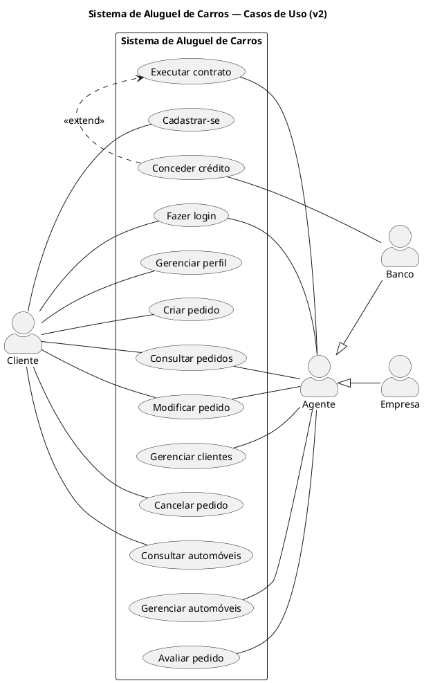 | 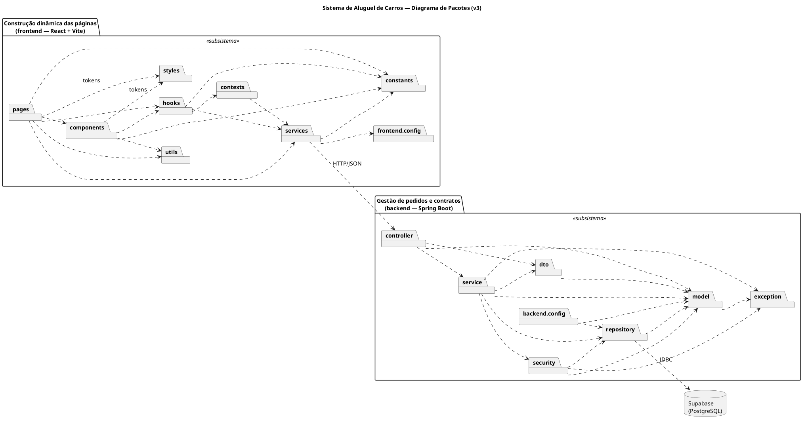 |

| Classes (v2) |
| :---: |
| 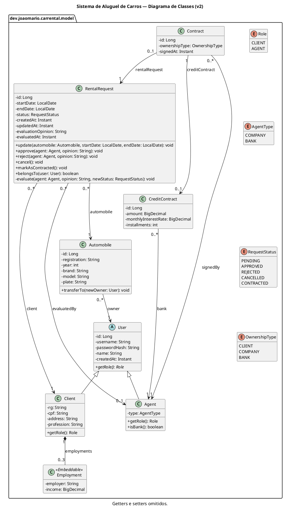 |

A versão inicial, feita antes do código, está em [`docs/uml/v1`](./docs/uml/v1/), e o que mudou entre as versões (e por quê) está em [`docs/uml/README.md`](./docs/uml/README.md).

---

## 🔧 Instalação e Execução

### Pré-requisitos

- **Java 25** (JDK)
- **Node.js 24** (a versão está em `frontend/.nvmrc`) e **npm**
- Uma conta no **Supabase**

### 1. Banco de dados

1. Crie um projeto no [Supabase](https://supabase.com/).
2. Em **Connect**, copie os dados do **Session pooler**: host, usuário (`postgres.<id-do-projeto>`) e a senha definida ao criar o projeto.

As tabelas são criadas pelo próprio back-end na primeira execução.

### 2. Back-end

```bash
git clone https://github.com/joaom-abreu/car-rental-system.git
cd car-rental-system/backend
cp .env.example .env
```

Preencha o `backend/.env`:

| Variável | O que colocar |
| --- | --- |
| `DB_URL` | `jdbc:postgresql://<host-do-pooler>:5432/postgres?sslmode=require` |
| `DB_USERNAME` | usuário do pooler |
| `DB_PASSWORD` | senha do banco |
| `JWT_SECRET` | saída de `openssl rand -base64 32` |
| `JWT_EXPIRATION_MINUTES` | validade do token em minutos (padrão `120`) |
| `CORS_ALLOWED_ORIGINS` | `http://localhost:5173` |
| `SEED_AGENT_PASSWORD` | senha dos agentes `locadora` e `banco` |
| `PORT` | `8080` |

Na primeira execução, o back-end cria a **Locadora Savassi** (`locadora`), o **Banco Pampulha** (`banco`) e quatro automóveis da locadora.

### 3. Front-end

```bash
cd ../frontend
npm install
```

Localmente o front não precisa de `.env`: ele usa `http://localhost:8080` como endereço da API.

### 4. Executar

Em dois terminais:

```bash
cd backend && ./mvnw spring-boot:run
```

```bash
cd frontend && npm run dev
```

Ou os dois juntos, de dentro de `frontend/`:

```bash
npm run dev:all
```

Depois, abra:

- Aplicação: [http://localhost:5173](http://localhost:5173)
- Swagger: [http://localhost:8080/swagger-ui.html](http://localhost:8080/swagger-ui.html)

---

## 🚀 Deploy

O back-end roda no **Render** a partir do `backend/Dockerfile`, e o front-end na **Vercel**. Os dois usam o mesmo banco do Supabase.

### 🖥️ Back-end no Render

1. Crie um **Web Service** ligado a este repositório, com linguagem **Docker** e **Root Directory** `backend`.
2. Cadastre as variáveis de ambiente (os valores ficam só no Render, nunca no código):

   | Variável | Uso |
   | --- | --- |
   | `DB_URL`, `DB_USERNAME`, `DB_PASSWORD` | Conexão com o Supabase (session pooler) |
   | `JWT_SECRET` | Assinatura dos tokens (gere com `openssl rand -base64 32`) |
   | `SEED_AGENT_PASSWORD` | Senha da locadora e do banco criados na primeira execução |
   | `CORS_ALLOWED_ORIGINS` | URL do front-end na Vercel |

   O Render define a variável `PORT` sozinho, e o Spring usa essa porta.

3. A cada push na `main`, o Render gera a imagem Docker e publica a nova versão.

O `Dockerfile` tem duas etapas: a primeira compila o projeto com Maven, e a segunda roda só o `.jar` numa imagem com o Java (JRE), sem o código-fonte nem o Maven.

### 💻 Front-end na Vercel

1. Importe este repositório na Vercel com **Root Directory** `frontend` (o preset Vite é detectado sozinho).
2. Cadastre a variável `VITE_API_URL` com a URL do back-end no Render, sem barra no final. Ela é lida no build: se mudar, faça um novo deploy.
3. O `frontend/vercel.json` manda todas as rotas para o `index.html`, para que recarregar uma página como `/pedidos/12` não dê erro 404.

Depois do primeiro deploy na Vercel, coloque a URL dela em `CORS_ALLOWED_ORIGINS` no Render.

---

## 📂 Estrutura de Pastas

```
.
├── .github/workflows/ci.yml        # ✅ CI: testes do back-end, lint e build do front-end.
├── docs/
│   ├── historias-de-usuario.md     # 📝 Histórias de usuário e regras de negócio.
│   ├── assets/                     # 🖼️ Imagens do README.
│   ├── screenshots/                # 📸 Prints da aplicação.
│   └── uml/                        # 📐 Diagramas UML (v1, v2 e v3) e histórico de versões.
├── backend/                        # 🖥️ API em Spring Boot.
│   ├── Dockerfile                  # 🐳 Imagem usada no Render.
│   ├── .env.example                # 🔑 Variáveis de ambiente, sem valores reais.
│   └── src/
│       ├── main/java/dev/joaomario/carrental/
│       │   ├── controller/         # 🚪 Endpoints REST.
│       │   ├── service/            # ⚙️ Regras de negócio e conversão para DTO.
│       │   ├── repository/         # 🗃️ Acesso ao banco.
│       │   ├── model/              # 🧱 Entidades e enums.
│       │   ├── dto/                # 📦 Dados de entrada e saída da API.
│       │   ├── security/           # 🔐 Spring Security, JWT e usuário logado.
│       │   ├── config/             # 🔧 CORS, Swagger e carga inicial.
│       │   └── exception/          # ⚠️ Erros em JSON num formato único.
│       └── test/java/dev/joaomario/carrental/  # 🧪 Testes dos services, controllers e erros.
└── frontend/                       # 💻 Interface em React + Vite.
    ├── vercel.json                 # 🔀 Rotas do React na Vercel.
    └── src/
        ├── pages/                  # 📄 Telas.
        ├── components/             # 🧩 Button, Field, Card, Logo, formulários e outras peças reutilizáveis.
        ├── services/               # 🔌 Chamadas à API (o único lugar com fetch) e o que fica salvo no navegador.
        ├── contexts/               # 👤 Sessão do usuário.
        ├── hooks/                  # 🪝 useAuth e useTheme.
        ├── constants/              # 🏷️ Rótulos de status e de propriedade, temas e dados do design system.
        ├── utils/                  # 🧮 Formatação e máscara de datas, CPF, moeda e porcentagem, e leitura de tokens.
        ├── config/                 # ⚙️ Endereço da API.
        └── styles/                 # 🎨 Tokens (cores, fontes e medidas dos dois temas) e estilos globais.
```

---

## 🎥 Demonstração

| Login | Cadastro de cliente |
| :---: | :---: |
| 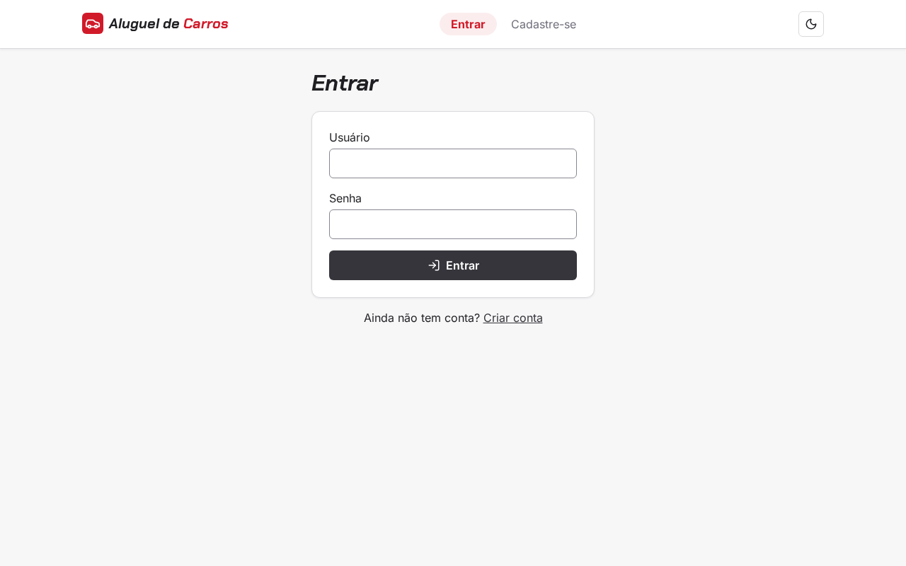 | 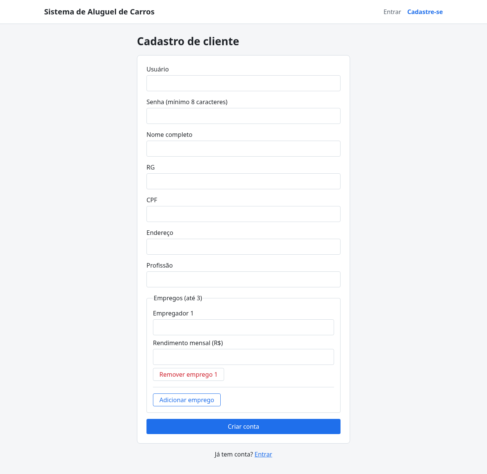 |

| Pedidos do cliente | Detalhe com avaliação e contrato |
| :---: | :---: |
| 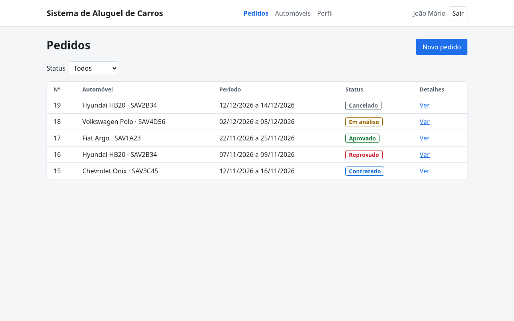 | 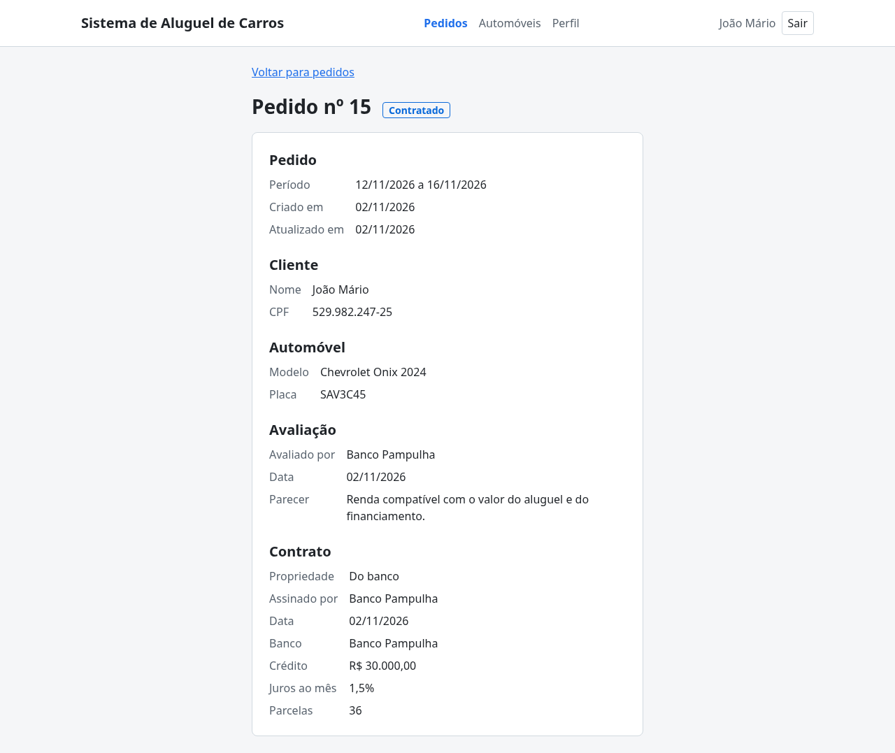 |

| Clientes (visão do agente) | Automóveis (visão do agente) |
| :---: | :---: |
| 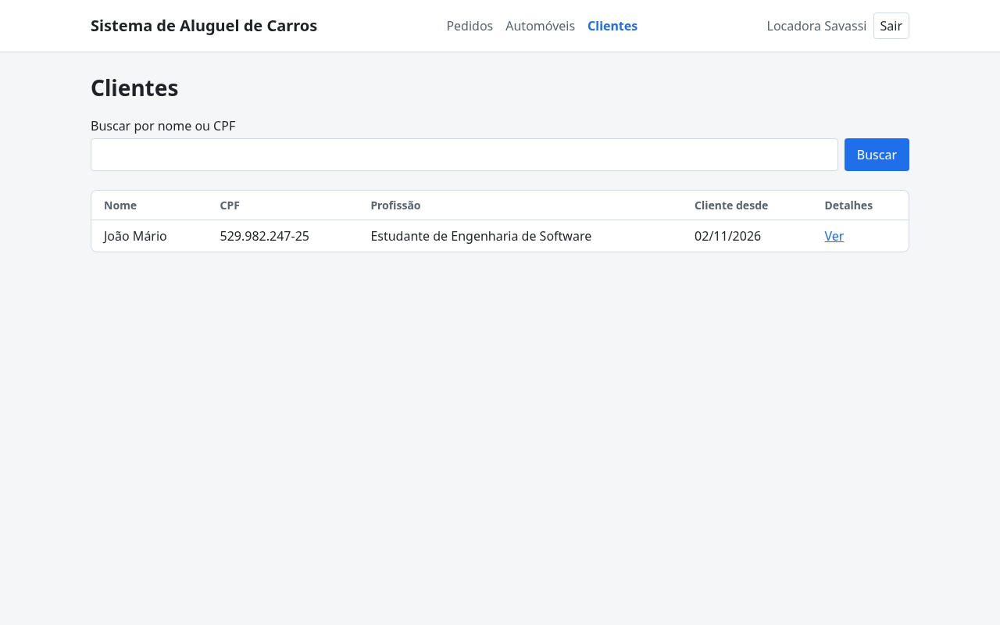 | 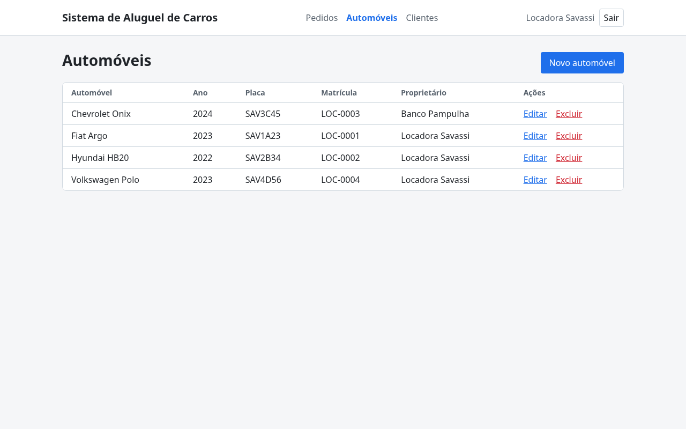 |

| Tema escuro (visão do agente) | Design system |
| :---: | :---: |
| 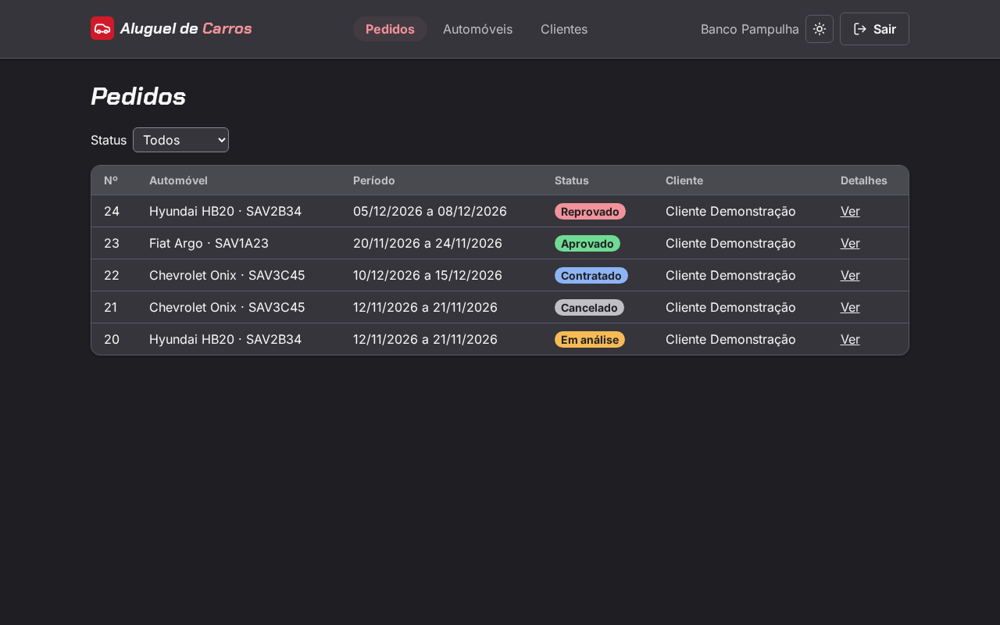 | 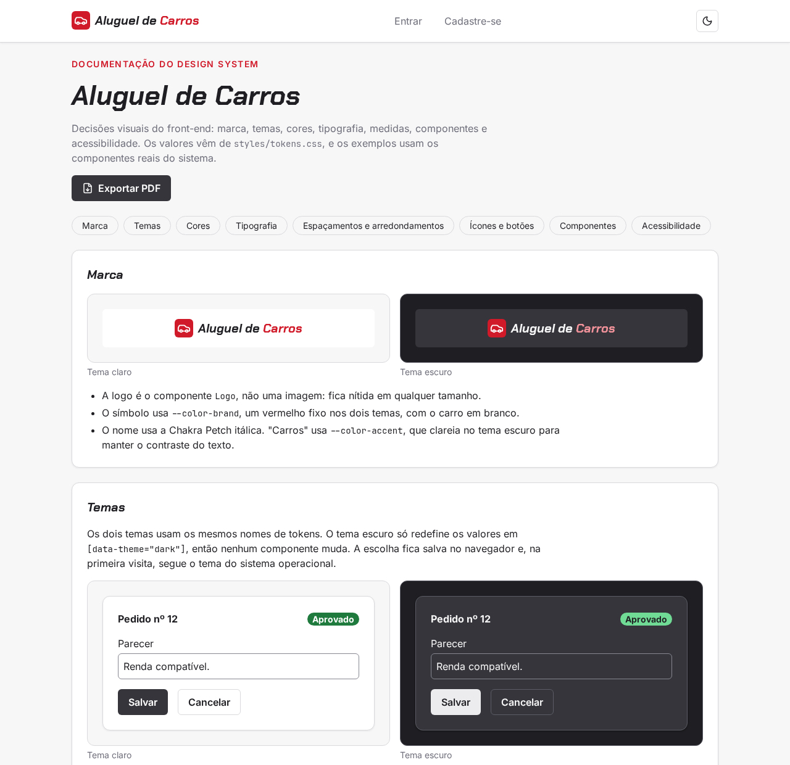 |

| Swagger |
| :---: |
| 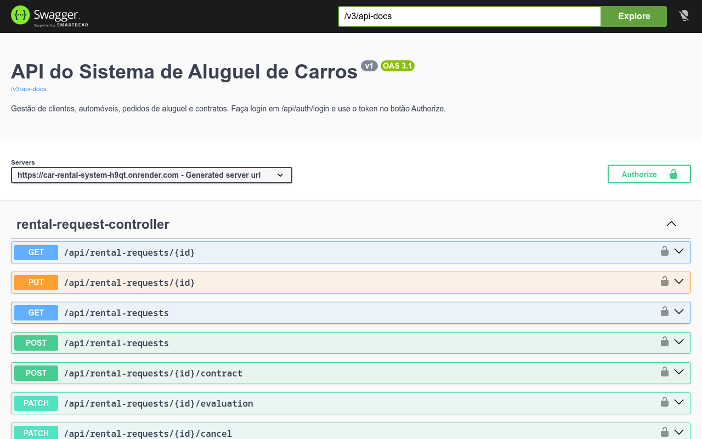 |

### 💻 Exemplo de chamada da API (cURL)

O login devolve o token JWT, que depois vai no cabeçalho `Authorization` das outras chamadas. As saídas abaixo são reais, da API publicada, com a conta de demonstração do cliente.

```bash
# Faz login com a conta de demonstração do cliente
curl -X POST 'https://car-rental-system-h9qt.onrender.com/api/auth/login' \
     -H 'Content-Type: application/json' \
     -d '{"username": "cliente.demo", "password": "aluguel2026"}'
```

**Saída esperada** (token encurtado):
```json
{
  "token": "eyJhbGciOiJIUzI1NiJ9...",
  "user": {
    "id": 19,
    "username": "cliente.demo",
    "name": "Cliente Demonstração",
    "role": "CLIENT",
    "agentType": null
  }
}
```

```bash
# Busca o pedido 22, contratado com crédito do banco, usando o token do login
curl -X GET 'https://car-rental-system-h9qt.onrender.com/api/rental-requests/22' \
     -H 'Authorization: Bearer <token-do-login>'
```

**Saída esperada:**
```json
{
  "id": 22,
  "status": "CONTRACTED",
  "startDate": "2026-12-10",
  "endDate": "2026-12-15",
  "createdAt": "2026-11-04T22:58:29.009493Z",
  "updatedAt": "2026-11-04T22:58:35.504834Z",
  "client": {
    "id": 19,
    "name": "Cliente Demonstração",
    "cpf": "11144477735"
  },
  "automobile": {
    "id": 3,
    "brand": "Chevrolet",
    "model": "Onix",
    "year": 2024,
    "plate": "SAV3C45"
  },
  "evaluation": {
    "agentName": "Banco Pampulha",
    "opinion": "Renda de R$ 5.000,00 compatível com o valor do aluguel. Crédito aprovado pelo banco.",
    "evaluatedAt": "2026-11-04T22:58:33.846337Z"
  },
  "contract": {
    "id": 5,
    "ownershipType": "BANK",
    "signedByName": "Banco Pampulha",
    "signedAt": "2026-11-04T22:58:35.703894Z",
    "credit": {
      "bankName": "Banco Pampulha",
      "amount": 8500.0,
      "monthlyInterestRate": 1.5,
      "installments": 12
    }
  }
}
```

---

## 🔌 Endpoints da API

Todas as rotas, menos login e cadastro de cliente, exigem o token no cabeçalho `Authorization: Bearer <token>`. Os erros saem sempre no mesmo formato JSON, com `status`, `message` e, quando for o caso, `fieldErrors` com o erro de cada campo.

| Método | Rota | Quem pode | O que faz |
| --- | --- | --- | --- |
| POST | `/api/auth/login` | público | Faz login e devolve o token |
| GET | `/api/auth/me` | logado | Devolve o usuário logado |
| POST | `/api/clients` | público | Cadastra um cliente |
| GET | `/api/clients?search=` | agente | Lista clientes, com busca por nome ou CPF |
| GET | `/api/clients/{id}` | agente ou o próprio cliente | Mostra um cliente |
| PUT | `/api/clients/{id}` | agente ou o próprio cliente | Edita um cliente |
| DELETE | `/api/clients/{id}` | agente ou o próprio cliente | Exclui um cliente sem pedidos |
| GET | `/api/automobiles` | logado | Lista os automóveis com o proprietário |
| GET | `/api/automobiles/{id}` | logado | Mostra um automóvel |
| POST | `/api/automobiles` | agente | Cadastra um automóvel (o agente vira o proprietário) |
| PUT | `/api/automobiles/{id}` | agente | Edita um automóvel |
| DELETE | `/api/automobiles/{id}` | agente | Exclui um automóvel sem pedidos |
| POST | `/api/rental-requests` | cliente | Cria um pedido |
| GET | `/api/rental-requests?status=` | logado | Lista pedidos (o cliente vê os seus; o agente vê todos) |
| GET | `/api/rental-requests/{id}` | dono ou agente | Mostra o pedido com avaliação e contrato |
| PUT | `/api/rental-requests/{id}` | dono ou agente | Modifica um pedido em análise |
| PATCH | `/api/rental-requests/{id}/cancel` | cliente dono | Cancela um pedido em análise ou aprovado |
| PATCH | `/api/rental-requests/{id}/evaluation` | agente | Aprova ou reprova com parecer |
| POST | `/api/rental-requests/{id}/contract` | agente | Executa o contrato, com crédito opcional do banco |

Os detalhes de cada rota, com exemplos, estão no [Swagger](https://car-rental-system-h9qt.onrender.com/swagger-ui.html).

---

## 🧪 Testes

Os testes do back-end não usam banco: os services são testados com **JUnit 5** e **Mockito**, e os controllers com **MockMvc** em modo standalone.

```bash
cd backend && ./mvnw test
```

| Classe de teste | Testes | O que cobre |
| --- | :---: | --- |
| `RentalRequestServiceTest` | 18 | Criação, datas, sobreposição de período, dono do pedido, modificação, cancelamento e avaliação |
| `ClientServiceTest` | 11 | CPF e usuário repetidos, limite de empregos, acesso aos próprios dados, busca e exclusão |
| `GlobalExceptionHandlerTest` | 10 | Formato JSON de cada tipo de erro (400, 401, 403, 404, 409 e 500) |
| `AutomobileServiceTest` | 7 | Placa antiga e Mercosul, placa repetida, faixa de ano, proprietário e exclusão |
| `ContractServiceTest` | 6 | As três regras de propriedade, crédito só pelo banco e contrato só de pedido aprovado |
| `AuthServiceTest` | 3 | Login com senha certa, senha errada e usuário inexistente |
| `JwtServiceTest` | 2 | Geração e leitura do token e recusa de token adulterado |
| `ClientControllerTest` | 2 | Cadastro com 201 e erros de validação com 400 |
| `RentalRequestControllerTest` | 2 | Validação do parecer da avaliação |

No front-end, o `lint` e o `build` conferem o código:

```bash
cd frontend && npm run lint && npm run build
```

O **GitHub Actions** roda os testes do back-end e o lint e o build do front-end a cada push e pull request na `main`.

---

## 📖 Documentações Utilizadas

- [Spring Boot](https://docs.spring.io/spring-boot/)
- [Spring Security](https://docs.spring.io/spring-security/reference/)
- [Spring Data JPA](https://spring.io/projects/spring-data-jpa/)
- [JJWT](https://github.com/jwtk/jjwt)
- [springdoc-openapi](https://springdoc.org/)
- [JUnit 5](https://junit.org/junit5/docs/current/user-guide/) e [Mockito](https://site.mockito.org/)
- [React](https://react.dev/)
- [React Router](https://reactrouter.com/)
- [Vite](https://vite.dev/)
- [Lucide](https://lucide.dev/guide/packages/lucide-react)
- [Google Fonts](https://fonts.google.com/)
- [WCAG 2.1: contraste mínimo](https://www.w3.org/WAI/WCAG21/Understanding/contrast-minimum.html)
- [Supabase](https://supabase.com/docs)
- [PlantUML](https://plantuml.com/)
- [GitHub Actions](https://docs.github.com/actions)
- [Render: deploy com Docker](https://render.com/docs/docker)
- [Vercel: Vite](https://vercel.com/docs/frameworks/frontend/vite)

---

## 👤 Autor

| 👤 Nome | 🖼️ Foto | :octocat: GitHub | 💼 LinkedIn | 📤 Gmail |
| --- | :---: | :---: | :---: | :---: |
| João Mário Abreu |  | <a href="https://github.com/joaom-abreu"></a> | <a href="https://www.linkedin.com/in/joao-mario-abreu"></a> | <a href="mailto:abreujoaomr@gmail.com"></a> |

---

## 📄 Licença

Este projeto é distribuído sob a **[Licença MIT](./LICENSE)**.
